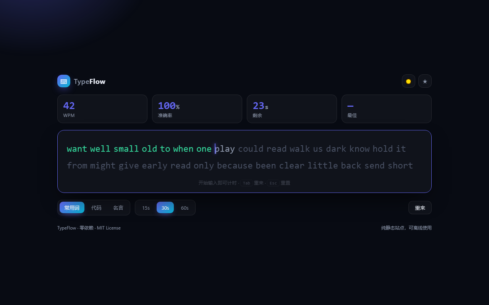

# TypeFlow · 极简打字速度测试

> 一个零依赖、单页面的英文打字速度测试工具。打开即用，支持深浅色主题、三种文本模式与本地成绩记录。

<p align="center">
  
</p>

<p align="center">
  <a href="https://github.com/-/typeflow/blob/main/LICENSE"></a>
  
  
</p>

---

## ✨ 特性

- **实时反馈** — WPM、准确率、剩余时间每秒刷新；当前字符有光标跟随。
- **逐字符着色** — 正确为绿、错误为红并带波浪线，跳过的字符单独标记。
- **三种文本模式** — 常用英文词 / 代码片段（练符号）/ 英文名言。
- **三档时长** — 15s、30s、60s。
- **自动换行滚动** — 当前行始终保持在可视区中间，长文本无缝续写。
- **成绩记录** — 按「模式 + 时长」分别保存个人最佳（localStorage）。
- **深浅主题** — 跟随系统，也可手动切换并记住选择。
- **键盘优先** — `Tab` 重来、`Esc` 重置 / 关闭成绩卡，全程不用鼠标。
- **零依赖** — 没有框架、没有构建步骤、没有网络请求，直接双击 `index.html` 就能用。

## 🚀 快速开始

```bash
git clone https://github.com/<owner>/typeflow.git
cd typeflow
```

然后直接双击 `index.html`，或起一个静态服务器：

```bash
python -m http.server 8000
# 打开 http://localhost:8000
```

> 页面不依赖任何后端，`file://` 协议下同样可用。

## 🧩 项目结构

```
typeflow/
├── index.html              # 页面结构
├── assets/
│   ├── style.css           # 全部样式与主题变量
│   └── app.js              # 打字引擎、统计与交互
├── docs/preview.png        # 预览图
├── .github/workflows/      # GitHub Pages 自动部署
├── LICENSE                 # MIT
└── README.md
```

## 🧮 计分方式

| 指标 | 说明 |
| --- | --- |
| WPM | `正确字符数 / 5 / 用时(分钟)`，即标准的五字符单词口径 |
| 准确率 | `正确字符 / (正确字符 + 错误字符)`，跳过的字符计入错误 |
| 最佳成绩 | 只在当前「模式 + 时长」组合内比较，刷新时提示新纪录 |

## 🎨 自定义

主题色集中在 `assets/style.css` 顶部的 CSS 变量里：

```css
:root {
  --accent: #6366f1;
  --accent-2: #06b6d4;
  --ok: #34d399;
  --bad: #f87171;
}
```

词库位于 `assets/app.js` 顶部的 `COMMON_WORDS`、`CODE_SNIPPETS`、`QUOTES`，直接增删即可。

## 🌐 部署

仓库已内置 `.github/workflows/pages.yml`。推送到 `main` 后：

1. 打开仓库 **Settings → Pages**；
2. 在 **Build and deployment → Source** 选择 **GitHub Actions**；
3. 等待 Actions 跑完，站点即发布在 `https://<owner>.github.io/typeflow/`。

一键发布脚本、手动 git 流程与网页上传步骤见 **[DEPLOY.md](DEPLOY.md)**。


## 📄 License

[MIT](LICENSE) © TypeFlow contributors

---

### English

**TypeFlow** is a tiny, dependency-free typing speed test that runs entirely in the browser. Real-time WPM and accuracy, per-character colouring, three text modes (common words, code snippets, quotes), three durations, localStorage personal bests, and light/dark themes. No build step, no frameworks — just open `index.html`.

Contributions are welcome: open an issue or send a PR.
